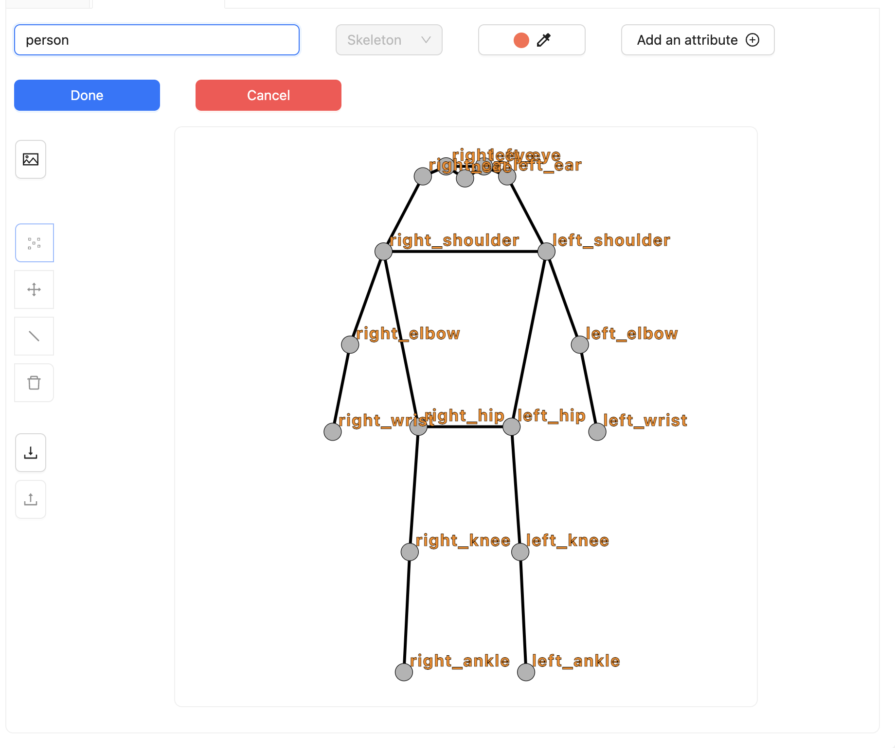
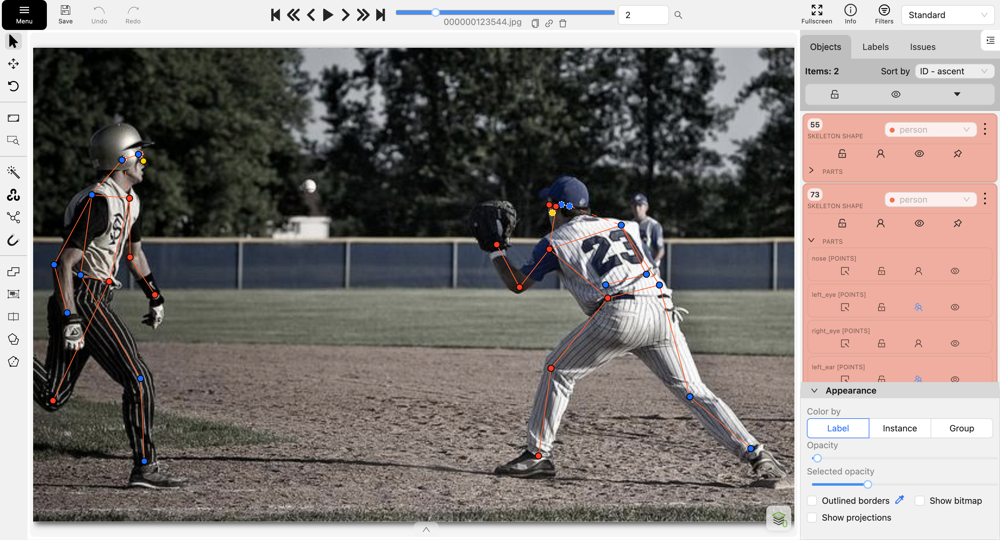
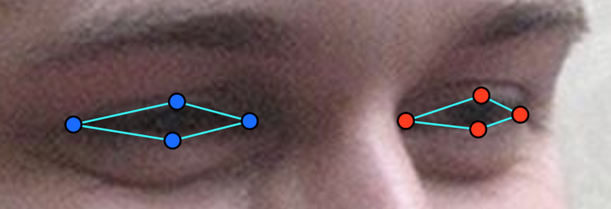
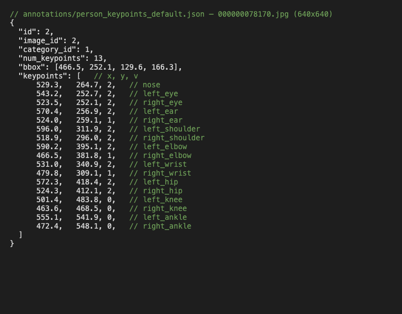

# Báo cáo cá nhân — TranQuangNam-2A202603118

Dữ liệu: 12 ảnh người COCO val2017 (Lin et al., 2014) và 8 ảnh chân dung Wikimedia Commons, chỉ dùng trong lớp.

## 0. Thông tin học viên

- Họ tên: Trần Quang Nam
- MSSV: 2A202603118
- Email: tranquangnam244@gmail.com
- Link repository: https://github.com/trannam229/K5-L2-DAY04-TranQuangNam-2A202603118-KeypointPose
- Phiên bản CVAT (Help → About): 2.74.1
- Máy: hệ điều hành macOS 26.6 · RAM 16 GB (Docker dùng 7.7 GB) · chạy CVAT chế độ đầy đủ
- Bộ ảnh (`src/exports/assignment.json` do `lab.py setup` tạo): có
- Giờ bắt đầu: 16:56 ngày 12/11/2026 (chạy `lab.py setup`)
- Giờ kết thúc: 19:18 ngày 12/11/2026 (lần `lab.py export` cuối)

## 1. Kiểm tra label (CP0)

| Label | Kiểu | Số điểm | Tên điểm đúng bảng của lab? | Đúng thứ tự? | Số cạnh |
|---|---|---:|---|---|---:|
| `person` | Skeleton | 17 | Có | Có | 19 |
| `face` | Skeleton | 13 | Có | Có | 13 |

Mẫu `person` dựng theo người quay mặt về camera (các điểm `left_*` nằm bên phải khung mẫu)? Có

Cách đổi cờ `occluded` / `outside` cho **một điểm** trên phiên bản CVAT này (một câu):

Trong sidebar Objects, mở skeleton ra danh sách điểm, rồi bấm nút `occluded` hoặc `outside` ở đúng dòng của điểm đó; chỉ điểm đó đổi kiểu hiển thị.

## 2. Số lượng đã gán và thời gian (CP1, CP2)

| Nhóm ảnh | Số ảnh | Số skeleton đã gán | Số người dưới 60 px (không gán) | Số poster / gương / màn hình bỏ qua | Thời gian (phút) |
|---|---:|---:|---:|---:|---:|
| `easy` | 5 | 5 | 0 | 0 | — |
| `occluded` | 3 | 6 | 0 | 0 | — |
| `back` | 2 | 3 | 0 | 0 | — |
| `small` | 1 | 1 | 3 | 0 | — |
| `crowd` | 1 | 3 | 0 | 0 | — |
| `faces` | 8 | 8 | — | 0 | — |

- Số ảnh người đã xong ở mốc phút 105: không ghi lại
- Thời gian thực tế (phút): không bấm giờ riêng từng checkpoint; tổng từ `lab.py setup` (16:56) đến lần `lab.py export` cuối (19:18) khoảng 142 phút cho CP0–CP4
- Ảnh tốn thời gian nhất là ảnh nào, vì sao?

`000000272026.jpg` (crowd) và `000000323705.jpg` (small): phải quay lại sửa sau khi script tự kiểm báo lỗi. Ở 272026 người bên trái bị cắt ở mép dưới, ban đầu để cổ chân `v = 2` ngoài ảnh. Ở 323705 người rất nhỏ, đứng sau lan can, lúc đầu bỏ sót.

## 3. Bảng ca khó (CP1, CP2)

| Ảnh | Người / mặt | Điểm | Cờ đã chọn | Phân vân giữa | Lý do chọn |
|---|---|---|---:|---|---|
| 000000272026.jpg | người 3 (áo trắng, bên trái) | `left_ankle`, `right_ankle` | 0 | `v = 2` / `v = 0` | Cổ chân nằm dưới mép ảnh (khớp thật ngoài khung), không kéo về mép nên là `outside` |
| 000000323705.jpg | người 1 (sau lan can, bên phải) | gối, cổ chân, cổ tay | 0 | `v = 1` / `v = 0` | Lan can che kín từ hông trở xuống, người quá nhỏ nên không ước lượng chắc vị trí khớp → `outside` |
| 000000123544.jpg | người 2 (mép trái) | `left_ankle` | 0 | `v = 1` / `v = 0` | Chân sau sải ra ngoài mép trái ảnh, khớp nằm ngoài khung → `outside` |
| 000000078170.jpg | người 1 (cửa sổ bên phải) | gối, cổ chân | 0 | `v = 1` / `v = 0` | Thành tàu che kín từ hông trở xuống, không có manh mối đoán chắc vị trí gối, cổ chân → `outside` |
| face_99874.jpg | mặt kính râm | 8 điểm mắt | 1 | `v = 2` / `v = 1` | Kính râm tối che mắt; đặt theo gọng kính, ước lượng chắc nên `occluded` theo guideline |

## 4. Bảng tự review (CP3)

Mã lỗi dùng đúng một trong: `lr_swap`, `vis_flag`, `position`, `missing`, `extra`, `ok`.

| Ảnh | Người / mặt | Điểm | Mã lỗi | Ghi chú | Đã sửa? |
|---|---|---|---|---|---|
| 000000272026.jpg | người 3 | `left_ankle`, `right_ankle` | `vis_flag` | Cổ chân ngoài ảnh (y = 757 > 480) nhưng để `v = 2` | Có (→ `outside`) |
| 000000323705.jpg | người 1 | cả người | `missing` | Ảnh chưa có skeleton nào | Có |
| 000000156986.jpg | người 2 (sau lưới) | cả người | `missing` | Bỏ sót người áo đen phía sau người trượt ván | Có |
| 000000516902.jpg | người 2 (áo xanh phía sau) | cả người | `missing` | Bỏ sót cậu bé đứng sau tay vợt | Có |
| 000000164659.jpg | người 1 | `*_knee`, `*_ankle` | `lr_swap` | Người quay mặt về camera nhưng gối và cổ chân trái nằm bên trái ảnh | Chưa (sửa trên CVAT rồi xuất lại) |
| 000000123544.jpg | người 2 (mép trái) | — | `ok` | Script cảnh báo cặp gối ngược phía; do tư thế chạy sải bước, không phải đổi trái/phải | — |
| face_99874.jpg | mặt kính râm | 8 điểm mắt | `ok` | Đúng `v = 1` | — |
| face_483667.jpg | mặt 1 | — | `ok` | | — |
| face_137371.jpg | mặt 1 | — | `ok` | | — |

Tổng hợp số lỗi theo mã:

| `lr_swap` | `vis_flag` | `position` | `missing` | `extra` | `ok` |
|---:|---:|---:|---:|---:|---:|
| 1 | 1 | 0 | 3 | 0 | 4 |

Điểm còn phân vân giữa `v = 1` và `v = 0` (ghi cả hai lựa chọn và lý do chọn):

Phần dưới của người 1 ảnh 323705: chọn `v = 0` thay vì `v = 1` vì lan can che kín và người chỉ cao vài chục pixel, ước lượng sẽ là đoán bừa.

## 5. Kiểm file xuất và kết quả tự kiểm (CP4)

Tự kiểm tay trong file JSON:

| File | Người / mặt kiểm (ảnh, thứ tự) | Số phần tử `keypoints` | Điểm `outside` ra `v = 0`, `occluded` ra `v = 1`? | `num_keypoints` khớp? |
|---|---|---:|---|---|
| `TranQuangNam_persons.zip` | 000000078170.jpg, người 1 | 51 | Có (4 điểm `v = 0`, 3 điểm `v = 1`) | Có (13) |
| `TranQuangNam_persons.zip` | 000000272026.jpg, người 1 | 51 | Có (4 điểm `v = 0`, 5 điểm `v = 1`) | Có (13) |
| `TranQuangNam_faces.zip` | face_99874.jpg (kính râm) | 39 | Có (8 điểm mắt `v = 1`) | Có (13) |

Sau khi xuất, CVAT ghi `occluded` thành `v = 1` và `outside` thành `v = 0`. Tọa độ của điểm `outside` trong file là `0, 0` hay tọa độ cũ? Tọa độ cũ (CVAT 2.x giữ nguyên tọa độ; điểm `v = 0` bị bỏ qua khi huấn luyện và khi chấm).

Hai job đã chuyển sang completed trên CVAT? Có

Dán phần **TÓM TẮT** in ra từ `src/check_submission.py`:

```text
- File person: TranQuangNam_persons.zip
  Số ảnh: 12 · số skeleton `person`: 18 · mỗi annotation 51 số
  Skeleton theo ảnh: 000000072098=1, 000000078170=2, 000000123544=2, 000000156986=2, 000000164659=1, 000000194027=1, 000000272026=3, 000000323705=1, 000000390585=1, 000000515309=1, 000000516902=2, 000000525227=1
  Cờ v: v=2 234 (76%) · v=1 32 (10%) · v=0 40 (13%)
  num_keypoints trung bình: 14.8
- File face: TranQuangNam_faces.zip
  Số ảnh: 8 · số skeleton `face`: 8 · mỗi annotation 39 số
  Skeleton theo ảnh: face_137371=1, face_145751=1, face_155465=1, face_380639=1, face_380754=1, face_442231=1, face_483667=1, face_99874=1
  Cờ v: v=2 95 (91%) · v=1 9 (9%) · v=0 0 (0%)
  num_keypoints trung bình: 13.0
- Ghi chú: 40 điểm v = 0 vẫn mang tọa độ cũ (CVAT 2.x xuất như vậy; chuẩn COCO ghi 0, 0). Không phải lỗi: điểm v = 0 bị bỏ qua khi huấn luyện và khi chấm.
- Số [LỖI]: 0 · số [CẢNH BÁO]: 3
Kết quả: ĐẠT (đọc lại từng cảnh báo ở trên)
```

Các `[CẢNH BÁO]` còn giữ nguyên và lý do:

- `000000123544.jpg #2`: người chạy nghiêng, đang sải bước; hai hông gần như chồng nhau (lệch 24 px) nên so phía giữa hông và gối không còn ý nghĩa. Giữ nguyên.
- `000000164659.jpg #1`: không giữ, đây là `lr_swap` thật (xem mục 4), sửa trên CVAT rồi xuất lại.
- `000000323705.jpg #1`: người bị lan can che từ hông trở xuống nên các điểm thấy được chỉ trải 32 px; ước lượng cả người cao hơn 60 px nên vẫn gán, phần dưới để `outside`. Giữ nguyên.

## 6. Ảnh chụp màn hình

1. Label `person` trong label constructor (đủ 17 điểm có tên):

   

2. Một người quay lưng đã gán, cờ đã đặt:

   

3. Một khuôn mặt đã gán 13 điểm, phóng to vùng mắt:

   

4. Một đoạn JSON xuất của một người:

   

Nguồn ảnh: COCO val2017 / Wikimedia Commons.

## 7. Tự đánh giá

1. Lỗi bạn mắc nhiều nhất hôm nay, và cách bạn sẽ tránh ở dự án thật:

   `missing`: bỏ sót người đứng phía sau hoặc bị che (156986, 516902, 323705). Ở dự án thật: trước khi gán, đếm hết người cao từ 60 px trong ảnh (kể cả người phía sau, người sau lan can) và ghi số ra, gán xong đối chiếu số skeleton với số đã đếm.

2. Một quy tắc bạn đề xuất thêm vào guideline (kèm ảnh ví dụ nếu có):

   Người bị vật che hoặc bị cắt khung: tính ngưỡng 60 px theo chiều cao ước lượng của cả người, không theo phần thấy được. Ví dụ `000000323705.jpg`: người sau lan can chỉ lộ đầu đến hông (điểm trải 32 px) nhưng cả người cao hơn 60 px.

3. Nhãn của bạn đi vào model ở đâu? Chọn một lỗi bạn đã sửa và nói nó sẽ làm model học sai thế nào (heatmap, trọng số trong loss, hay bước lật ảnh):

   Lỗi `vis_flag` ở 272026: cổ chân ngoài ảnh mà để `v = 2` sẽ tạo một đỉnh heatmap ở tọa độ ngoài khung (hoặc bị cắt về mép) và được tính vào loss với trọng số đầy đủ. Model sẽ học "người bị cắt khung thì cổ chân nằm ở mép dưới", sinh dự đoán sai tự tin. Để `v = 0` thì điểm này bị loại khỏi loss.

## 8. Khó khăn và lỗi kỹ thuật

- `python lab.py check` phát hiện tên `nuclio` bị trỏ sang 172.20.0.11 (nguy cơ kẹt "Connecting..."); script tự thêm `docker-compose.override.yml` và khởi động lại `cvat_server`, sau đó chạy bình thường.
- Lần xuất thứ hai thiếu phần lớn chỗ đã sửa vì chưa lưu (`Ctrl+S`) trên CVAT; lưu rồi xuất lại thì đủ.

## Bonus (nếu làm)

### B1 — 3 ảnh người khó thêm

| Ảnh | Số skeleton | Số người dưới 60 px | Ca khó nhất |
|---|---:|---:|---|
| | | | |
| | | | |
| | | | |

Kết quả `src/check_submission.py` cho `HoVaTen_bonus_persons.zip`:

```text
(dán ở đây)
```

### B2 — 5 ảnh khuôn mặt đen trắng / hồng ngoại

Ảnh không màu khó hơn ở điểm nào? Kính râm trên ảnh hồng ngoại có còn là `v = 1` không?

...

### B3 — Model so với nhãn của tôi (không tính điểm)

- Demo đã dùng:
- Ảnh đã thử:

1. Model có trả điểm cho khớp bị che, hay khớp ngoài ảnh không? Confidence ở các điểm đó thế nào?

   ...

2. Với người quay lưng, model có đổi trái/phải không?

   ...

3. Bộ điểm của model có giống 17 điểm COCO không?

   ...

## 9. Tài liệu tham khảo và công cụ AI đã dùng

- Tài liệu của lab: `docs/GUIDELINE.md`, `docs/CVAT_CHEATSHEET.md`, `docs/COCO_KEYPOINTS.md`.
- Claude Code (trợ lý AI): chạy `lab.py check` / `setup` / `export`, đọc kết quả `src/check_submission.py` và chỉ ra chỗ cần kiểm lại, điền các mục dữ kiện của báo cáo (0, 1, 2, 5), commit và push. Không dùng AI hay model để sinh điểm keypoint; toàn bộ nhãn gán tay trên CVAT.
- Với sự cho phép của giảng viên: các mục 2, 3, 4, 5, 7, 8 do Claude Code soạn dựa trên lịch sử lỗi của `src/check_submission.py` qua các lần xuất và tọa độ trong file xuất.
